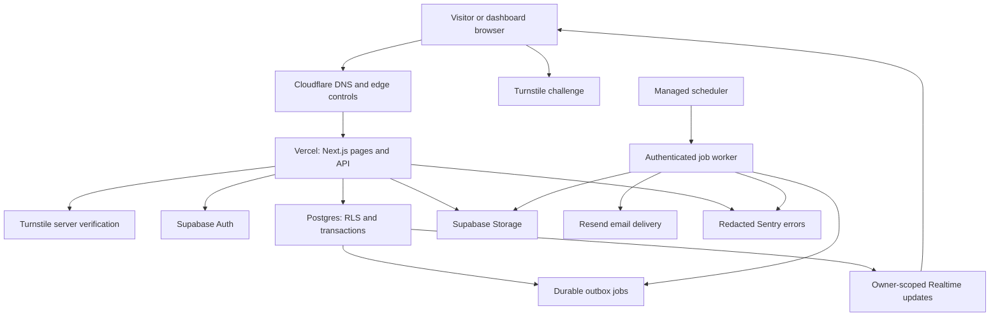
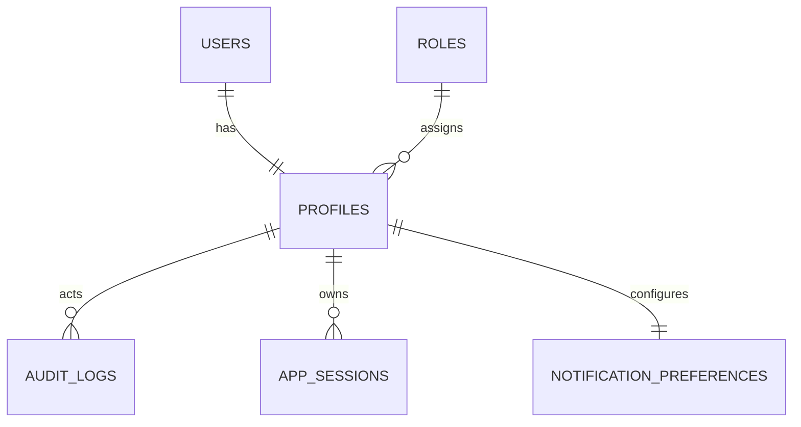
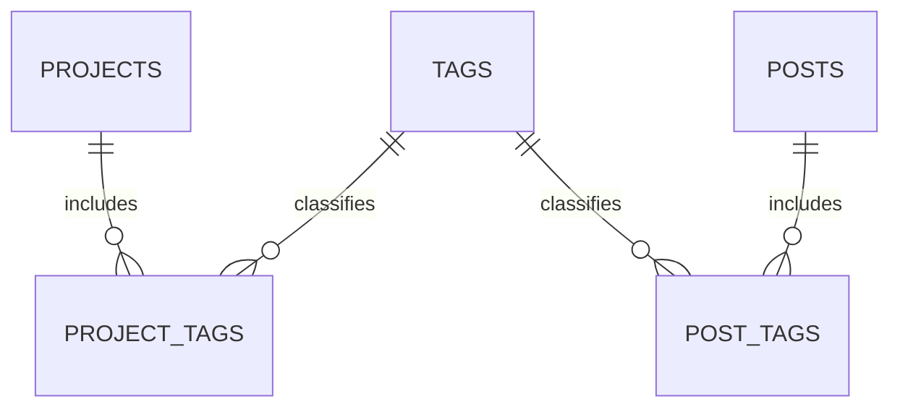
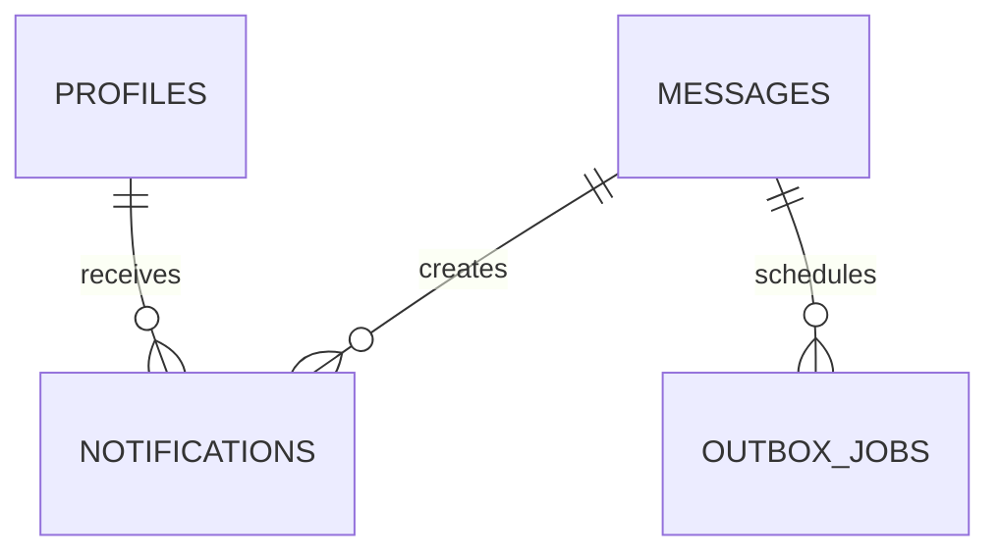

# DevFolio architecture — Track A

Status: original Phase 2 design retained below; version 3.0.0 now supplies the Phase 4 implementation described in [PHASE_4.md](PHASE_4.md). External setup and runtime/security acceptance remain pending. [REQUIREMENTS.md](REQUIREMENTS.md) defines the acceptance targets; [STATUS.md](STATUS.md) distinguishes current source from future work.

## Version 3.0.0 implementation delta

The implemented schema uses `profiles.role` referencing fixed `roles.code`, joined tag tables, media IDs on projects/posts, and the private operational schema `portfolio_private`. That schema is not exposed through the Data API. Exposed privileged RPC wrappers are SECURITY INVOKER; non-exposed implementations have pinned search paths and explicit execution grants. CMS data operations use the verified user's RLS-scoped client. Bootstrap, session bookkeeping, validated media storage and contact/outbox operations use a server-only privileged client.

Auth is a server-mediated cookie model with HTTP-only cookies and no direct browser Supabase client. Owner notification updates use 15-second HTTP polling instead of the planned Realtime connection; polling does not extend idle time. Public database pages use fresh anonymous SSR instead of the initially proposed ISR. This prioritizes current publication state while cache performance remains unmeasured. Public image responses have a 60-second cache TTL.

Actual handlers, setup, operator-run scheduler, limitations and acceptance instructions are in [PHASE_4.md](PHASE_4.md). The earlier design below records broader targets; it is not evidence that every operation or NFR is live. The original `app_sessions`, outbox and rate-limit concepts are implemented in the private schema. Multi-image attachment collections, a global site-settings editor, automatic retention/orphan cleanup and measured performance remain future work.

## Decisions and boundaries

Use the existing Next.js App Router, React, TypeScript, and Tailwind project. Preserve the explicitly Zelda-themed public identity. Add Supabase for managed authentication, Postgres, RLS, and Storage; use Resend for email and Cloudflare for DNS/Turnstile. Vercel hosts pages, Route Handlers, and the authenticated Node worker entrypoint.

Track A reduces the number of independently deployed application servers while still requiring real database policies, server validation, authorization, migrations, and jobs. Track B remains possible, but introducing a separate Render API is not necessary for this baseline. Provider selection is not proof of a working integration or an uptime/latency guarantee.



Cloudflare proxying, WAF entitlements, and SSL settings must be checked for the selected plan. If Cloudflare only provides DNS, origin-side validation/rate limiting still protects API requests. Verify rate limiting is not bypassed through the provider's direct deployment domain.

### Client and server responsibilities

| Browser | Trusted server/database |
|---|---|
| Project tag filters, pagination controls, loading/empty/error feedback | Select only published public records; paginate and bound inputs |
| Login forms and OAuth navigation | Verify identity/token and safe redirect destinations |
| Permission-aware controls | Read the authoritative role; check every action; enforce RLS |
| Markdown draft/preview state | Validate and sanitize stored/rendered Markdown |
| Upload file selection and progress | Authorize uploads, validate actual bytes, process derivatives |
| Contact form and Turnstile widget | Verify Turnstile, enforce shared rate limits, commit message/jobs |
| Notification badge presentation | Keep counts correct and restrict notification/message access |
| Theme preference | No security decisions from browser theme/storage state |

Privileged secrets never cross this boundary. Public Supabase URL/publishable key and the Turnstile site key may be exposed; Supabase secret/service-role credentials, email keys, job credentials, and database/backup passwords may not.

## Page and rendering contract

Public data access uses an anonymous, non-session client. Private pages use verified user identity and user-scoped access. Never place a `Set-Cookie` response or user-specific result into a shared public cache.

| Route | Rendering strategy | Reason |
|---|---|---|
| `/` | ISR with publication-driven invalidation | Featured work changes through the CMS but should remain cacheable. |
| `/about` | SSG | Biography changes infrequently; the current about section can be reused. |
| `/projects` | Cached public data + CSR filters, or ISR per query | Public records are shared; filter/page state stays in the URL. Never cache one filter's data under another key. |
| `/projects/[slug]` | ISR | Published details are shared; unpublished slugs return 404. |
| `/blog` | ISR + paginated query state | New published writing should appear without a full redeploy. |
| `/blog/[slug]` | ISR | Server-render sanitized Markdown and public metadata. |
| `/contact` | SSG shell + CSR form | A shared form shell needs no user session; submission is server-side. |
| `/privacy` | SSG | Publish the approved privacy/retention/deletion information. |
| `/login`, `/signup`, `/forgot-password` | Dynamic shell + client form | Auth state and nonce-based CSP must not become shared cached output. |
| `/reset-password` | Dynamic | Requires a valid recovery flow; never trust a query parameter as authorization. |
| `/auth/callback` | Server Route Handler | Exchange the provider code with PKCE/state checks and a local redirect. |
| `/admin` and all admin children | SSR, private/no-store | Role-sensitive data must be current and never shared across users. |
| `/admin/projects`, `/admin/blog` | SSR list + CSR editing | Initial role/data are trusted; edits and Markdown preview are interactive. |
| `/admin/messages`, `/admin/users`, `/admin/settings`, `/admin/audit` | Owner-only SSR + CSR actions | Contains private correspondence, users, settings, or audit information. |
| `/health` | Dynamic, no-store | Reports a fresh, bounded database probe, not a cached healthy response. |
| 404/error/loading boundaries | Appropriate route boundary | Preserve useful recovery and do not reveal internal errors. |

The current `generateStaticParams` restricts project routes to local built entries. Database-backed publication must replace that restriction so new CMS slugs become reachable without a redeploy. Publishing/unpublishing must invalidate home, project/blog lists, affected detail routes, tags, and sitemap data. Cache keys include filter and pagination inputs.

## Authentication and sessions

1. Register/login through Supabase Auth; verify email ownership. New profiles receive only Viewer, regardless of submitted metadata.
2. Use the current Supabase SSR cookie/client pattern. In Next.js 16 the request interceptor is `proxy.ts`, replacing the older `middleware.ts` convention used by the activity. Proxy redirects improve UX; the server layout and every protected operation still authorize independently.
3. Verify identity using the supported verified-claims/user APIs, not the user object from an unverified `getSession()` result. Look up role from server-controlled records for each protected operation so demotions take effect promptly.
4. Use cookie protection and an origin/CSRF policy appropriate to the selected SSR integration. Restrict callback/return URLs to the configured site. Password recovery uses the provider's recovery session, not an email address supplied by the client.
5. Application idle enforcement uses `app_sessions`, keyed by the provider's verified session identifier. A trusted callback or server login establishes the row; the browser cannot create arbitrary sessions or revive an expired one. A guard checks `revoked_at`, `last_activity_at`, and `absolute_expires_at` **before** allowing a bounded activity update. Do not count background polling as activity.
6. Include the same session eligibility checks in private data policies/RPCs, so a still-valid JWT cannot bypass the app's idle policy by calling the database directly. Restrict session-row creation/touching to verified, controlled server paths. Logout revokes the app session and ends the provider session.

Supabase's own inactivity/lifetime settings are plan-dependent and checked on token refresh. The proposed 30-minute app idle guard is therefore separate work, with its own tests. No free-tier provider timeout is assumed. Managed controls can replace/supplement it only after their exact timing satisfies the acceptance policy.

## Schema and relationships

`auth.users` is Supabase's managed identity table, labeled USERS in the ERD. Do not create a second password table. The application `profiles` table references it and contains one `role_id` referencing `roles`. `roles.code` is constrained to owner/editor/viewer; Guests have no row.

Identity, session, and audit relationships:



Content classification relationships (project/post authors reference profiles):



Inbox, notification, and delivery relationships:



Media joins and their parent visibility rules are specified in the schema table below.

| Table | Main fields and constraints | Access/index design |
|---|---|---|
| `auth.users` | Managed ID, provider identities, verified email, credential lifecycle | Auth provider only; no browser service credentials. |
| `roles` | `id`, unique `code` in owner/editor/viewer | Fixed migration/seed data; no client role creation. |
| `profiles` | `user_id` PK/FK, `role_id` non-null default Viewer, display name, active state, timestamps | Self-read minimal profile; Owner user-directory/role operations; roles cannot be edited through a general profile endpoint. |
| `projects` | UUID, unique slug, title, description, case-study fields, `publication_status` draft/published, `stage`, author/updater IDs, timestamps | Public published-only read; content managers edit; Owner deletes; index publication/status and stable list order. |
| `tags` | UUID, unique normalized slug/name | Public content vocabulary; Editor/Owner add/edit, Owner delete; no orphan join rows. |
| `project_tags` | Composite PK `(project_id, tag_id)` and FKs | Index `(tag_id, project_id)` for filtering; parent project visibility controls public joins. |
| `posts` | UUID, unique slug, title/excerpt, Markdown, draft/published, author/updater IDs, publication timestamps | Same content roles; public published-only; index publication/list ordering. |
| `post_tags` | Composite PK `(post_id, tag_id)` | Reverse tag index and parent-post visibility. |
| `messages` | UUID, name/email/subject/body, state unread/read/archived/spam, timestamps, deletion/retention state | Owner-only rows; guests cannot list/select/update messages; index state/created/id. |
| `notifications` | UUID, recipient ID, message/event reference, type, read time | Recipient-only read/update; unique event/recipient/type constraint; index recipient/unread/time. No raw message body in notification payload. |
| `notification_preferences` | Owner ID, owner-email flag, sender-confirmation flag, badge flag | Owner-only mutations; checked when queueing and again before delivery as appropriate. |
| `site_settings` | One record for public brand/contact values and separately protected operational values | Public projection exposes only allowed fields; Owner-only writes/private reads. |
| `media` | UUID, uploader, private original path, derivative path/dimensions/MIME, pending/ready/rejected state, timestamps | Content managers upload; private originals; public derivatives only when attached to published content. |
| `project_media` | Project/media FKs, alt text, ordering | Parent project and media readiness determine visibility. Apply the same attachment pattern to posts. |
| `audit_logs` | UUID, actor ID or service/guest classification, action, entity type/ID, timestamp, request ID, redacted change summary | Append-only trusted writes; Owner-only full read; index entity/time and actor/time. |
| `app_sessions` | Verified provider session ID, user ID, last activity, absolute expiry, revoked time | Private table; controlled session guard/touch functions; index user/expiry. |
| `outbox_jobs` | UUID, type, entity/event reference, unique idempotency key, state, attempt count, next-run time, lease expiry, redacted failure | Worker-only lifecycle; index state/next-run; do not store arbitrary client-supplied executable job payloads. |
| `rate_limit_buckets` | Hashed client/route key, window, count, expiry | Atomic server/database increments shared across instances; no client reads; expire keys. |

Every exposed application table has RLS enabled and explicit grants. Private tables/functions live in a non-exposed schema where possible. Policies and SQL functions are deny-by-default; trusted `security definer` functions have fixed search paths, restricted execute grants, and explicit authorization. Normal user operations use the user's identity/RLS, not a privileged client that silently bypasses policies.

### Transaction and data invariants

- The server/database derives the actor; never accept an actor ID or role from the request body.
- Database triggers or controlled transactional functions record business mutations alongside their audit entries. A failed audit write must fail the mutation. Audit rows themselves do not recursively audit their own inserts.
- Contact acceptance inserts message, notification, and outbox events atomically. HTTP success follows commit. An email provider failure after commit does not erase the message.
- Owner bootstrap uses a trusted operator procedure after verifying the intended UID; no signup route can bootstrap an Owner. Role/deletion transactions protect the last active Owner, including concurrent requests.
- Use unique constraints for slugs/idempotency and optimistic version checks for concurrent edits. Return 409 on a real conflict instead of overwriting someone else's work.
- Validate request limits; use stable cursor ordering such as `(created_at, id)` or documented bounded offset pagination, with a default 12 and hard maximum 50.

## API contract

The following endpoints are planned and do not exist in the current source. Server Actions may call the same service functions, but may not skip this authorization/validation contract.

### Common request/response rules

`200` reads/updates, `201` creates, `202` accepted background work, `204` successful deletion/logout. Errors: `400` malformed request, `401` missing/expired identity, `403` authenticated but forbidden or failed origin/challenge policy, `404` absent/unpublished resource, `409` slug/version/last-Owner conflict, `422` schema validation, `429` rate limited with retry guidance, `500` unexpected failure, `503` dependency unavailable. Responses contain a request ID; never send raw provider/SQL errors or tokens.

List query: `tag?`, `cursor?`, `limit=12` where applicable. Response: `{ data: [...], page: { nextCursor, hasMore } }`, with at most 50 rows. Private lists also support the explicit state/status filter in the row below.

Auth submissions are origin-checked and rate-limited. Required mutation schemas reject unknown privilege/actor fields.

| Method/path | Caller | Request shape | Success response/purpose |
|---|---|---|---|
| `POST /api/auth/signup` | Guest | Email, password, display name | Generic 202 confirmation instructions; provider-controlled credentials; Viewer profile only. |
| `POST /api/auth/login` | Guest | Email/password, safe local return path | 200 minimal account state plus secure session cookies. |
| `POST /api/auth/oauth` | Guest | Provider=`github`, safe local return path | 200 allowed provider redirect URL; PKCE/state flow. |
| `GET /auth/callback` | Auth flow | Provider code and verified flow state | Redirect to allowed local destination, or safe error page. |
| `POST /api/auth/forgot-password` | Guest | Email | Generic 202 regardless of account existence. |
| `POST /api/auth/reset-password` | Valid recovery session | New password | 200 updated account state; old/recovery sessions handled according to provider policy. |
| `POST /api/auth/logout` | Any signed-in user | No privilege fields | 204; revoke app/provider session. |
| `GET /api/auth/session` | Signed-in user | None | 200 own minimal profile/role/idle expiry; no raw tokens. |
| `POST /api/auth/activity` | Active signed-in user | CSRF-protected meaningful activity | 204 bounded session touch; cannot revive idle/revoked sessions. |
| `GET /api/projects` | Public | Tag/cursor/limit | 200 published records only. |
| `GET /api/projects/[slug]` | Public | URL slug | 200 published detail or 404. |
| `GET /api/posts` | Public | Tag/cursor/limit | 200 published post summaries. |
| `GET /api/posts/[slug]` | Public | URL slug | 200 published sanitized post detail or 404. |
| `GET /api/tags` | Public | Cursor/limit | 200 bounded public tag vocabulary. |
| `GET /api/site` | Public | None | 200 allowlisted public brand/contact settings. |
| `GET /api/admin/projects` | Viewer/Editor/Owner | Publication filter/cursor/limit | 200 non-sensitive content records, including drafts. |
| `POST /api/admin/projects` | Editor/Owner | Project schema, tag/media IDs | 201 saved draft + version. |
| `GET /api/admin/projects/[id]` | Viewer/Editor/Owner | UUID | 200 editable/preview detail with version. |
| `PATCH /api/admin/projects/[id]` | Editor/Owner | Allowed fields, draft/published, expected version | 200 saved content/version and public-cache invalidation. |
| `DELETE /api/admin/projects/[id]` | Owner | Expected version | 204 removed content, audited. |
| `GET /api/admin/posts` | Viewer/Editor/Owner | Publication filter/cursor/limit | 200 drafts/published summaries. |
| `POST /api/admin/posts` | Editor/Owner | Title/slug/excerpt/Markdown/tag/media schema | 201 saved draft. |
| `GET /api/admin/posts/[id]` | Viewer/Editor/Owner | UUID | 200 Markdown draft and version. |
| `PATCH /api/admin/posts/[id]` | Editor/Owner | Allowed fields/publication/expected version | 200 sanitized validated content/version. |
| `DELETE /api/admin/posts/[id]` | Owner | Expected version | 204 audited removal. |
| `POST /api/admin/tags` | Editor/Owner | Name/slug | 201 tag. |
| `PATCH /api/admin/tags/[id]` | Editor/Owner | Name/slug/expected version | 200 updated tag. |
| `DELETE /api/admin/tags/[id]` | Owner | Explicit detach policy | 204 removal without orphan joins. |
| `POST /api/contact` | Public | Name/email/subject/body, Turnstile token, idempotency key | 201 `{ saved: true, reference }` after message/jobs commit; does not assert email delivery. |
| `GET /api/admin/messages` | Owner | State/cursor/limit | 200 private inbox summaries. |
| `GET /api/admin/messages/[id]` | Owner | UUID | 200 private message. |
| `PATCH /api/admin/messages/[id]` | Owner | State=read/archived/spam/unread | 200 updated state; badge changes. |
| `DELETE /api/admin/messages/[id]` | Owner | Verified deletion workflow/expected version | 204 permanent application deletion and redacted audit entry. |
| `GET /api/notifications` | Signed-in user | Own notifications/cursor/limit | 200 only that user's allowed notifications. |
| `GET /api/notifications/unread-count` | Signed-in user | None | 200 aggregate count; Owner badge reflects unread inbox state/preferences. |
| `PATCH /api/notifications/[id]` | Recipient | Read state only | 200 own notification. |
| `GET /api/admin/users` | Owner | Cursor/limit | 200 bounded minimal user directory. |
| `PATCH /api/admin/users/[id]/role` | Owner | Role=owner/editor/viewer, expected version | 200 authoritative role update; last-Owner protection. |
| `DELETE /api/admin/users/[id]` | Owner | Explicit delete confirmation and expected version | 204 after safe content reassignment/provider handling; last-Owner protection. |
| `GET /api/admin/settings` | Owner | None | 200 operational values without secrets. |
| `PATCH /api/admin/settings` | Owner | Allowlisted public settings and notification toggles | 200 persisted settings/preferences. |
| `GET /api/admin/media` | Viewer/Editor/Owner | State/cursor/limit | 200 metadata permitted by role; no private original download to demo Viewers. |
| `POST /api/admin/media/uploads` | Editor/Owner | File name/type/size and content association | 201 upload ID plus short-lived signed private upload URL. |
| `POST /api/admin/media/[id]/complete` | Editor/Owner | Upload completion reference | 202 queued validation/derivative job. |
| `GET /api/admin/media/[id]` | Authorized content manager | UUID | 200 pending/ready/rejected status and safe derivative metadata. |
| `DELETE /api/admin/media/[id]` | Owner | Attachment/deletion policy | 202 audited storage cleanup job; reject unsafe deletion of referenced assets. |
| `GET /api/admin/audit` | Owner | Entity/actor/time/cursor/limit | 200 redacted, append-only audit records. |
| `POST /api/internal/jobs/run` | Trusted scheduler only | Authenticated bounded job lease request | 200 job summary; no user-session authorization fallback. |
| `POST /api/internal/email-events` | Verified provider webhook | Signed delivery/bounce event | 200 idempotent delivery-state update. |
| `GET /health` | Public, rate-limited | None | 200 bounded healthy probe or 503 unavailable; no sensitive diagnostics. |

Contact idempotency uses a unique server-side event key and canonical payload comparison; reusing a key with different content returns 409. A retry of an already committed same-payload request returns its original acknowledgment without reusing/consuming a Turnstile token or creating another message. First acceptance still requires a valid challenge. Test racing requests.

## Background delivery and media

### Contact delivery

1. Validate/rate-limit the request, verify Turnstile server-side including expected hostname/action, and validate the contact schema.
2. Commit message, Owner notification, and enabled delivery jobs in a single transaction.
3. A durable scheduler wakes a worker; claim a bounded batch with a lease and transactional locking. A crashed worker's lease expires so another run can retry.
4. Send the Owner and sender emails as distinct jobs, with distinct stable provider idempotency keys and persisted attempt results.
5. Retry transient failures with bounded backoff. Resend's idempotency window is 24 hours; retries beyond that window require explicit reconciliation/manual review rather than a blind duplicate send. Dead-letter failures remain visible to the Owner.
6. Verify signed provider events and update sent/delivered/bounced states idempotently. A provider-accepted email is not proof of recipient delivery.
7. Realtime subscriptions are recipient/Owner scoped; polling is a fallback and never counts as user activity.

Exact scheduler frequency, plan quota, job lease, and retry budget must be configured and demonstrated at the backend checkpoint. Supabase Cron plus an authenticated worker is the baseline; no paid scheduler capability is assumed.

### Media processing

Authorize upload intent before issuing a signed private path. Proposed first-release limits are 5 MiB and 20 megapixels per raster image; verify magic bytes and decoded dimensions rather than trusting a filename/MIME header. Re-encode with a supported Node image library, strip metadata, generate bounded WebP/AVIF derivatives, and mark ready only after success. Reject arbitrary uploaded SVG/HTML for this first release; repository-owned theme SVG is a separate trusted asset.

Keep originals private. Serve only approved derivatives associated with published content through `next/image` and a narrowly configured storage host. Orphan removal and referenced-image deletion run through auditable jobs with retry behavior. The selected worker must support the image-processing library within its execution/memory limits; this is an implementation gate.

## Security, privacy, and operations

### Policy boundaries

Public reads permit only published content. Private data is denied unless explicitly allowed by the matrix. Owner-only server operations may use a privileged Supabase client only after verifying the actor and action; isolate that client from normal page/data access. Keep privileged keys out of all `NEXT_PUBLIC_` variables.

Use shared distributed limits, initially proposed at five accepted contact messages per 15 minutes per privacy-preserving client key plus a longer email quota, and stricter auth-attempt limits. Final values are deployment settings, not measured protections in the existing code. Validate trusted proxy headers; an attacker-supplied IP header must not choose their rate-limit identity. Do not rely solely on Cloudflare if the Vercel origin is reachable.

### CSP and caching decision

Use a nonce-based policy on dynamic auth/admin pages with private/no-store responses. Public SSG/ISR pages need a compatible policy rather than accidentally reading a nonce and disabling all caching. Initial public policy follows the framework's documented non-nonce pattern with a documented inline-script allowance; do not permit arbitrary remote script sources or production `unsafe-eval`. Restrict frame/connect/script origins to those required for Turnstile and configured services, set object/base/form/frame restrictions, and sanitize Markdown. A stricter build-hash/SRI approach is a later reviewed change because the framework support is experimental.

This is an explicit security/performance trade-off, not a claim that an inline allowance provides the same protection as a strict nonce policy. Validate actual production CSP, HSTS, frame protection, hydration, challenge execution, OAuth, and image loading. The current source has some security headers but no completed CSP/HSTS deployment evidence.

### Retention and deletion

Before collecting real contact messages, publish an approved privacy policy naming actual processors, purposes, retention, and a verified deletion contact. Proposed operational defaults for review: messages 90 days unless active correspondence justifies retention, spam 30 days, rate-limit keys no longer than their anti-abuse window, and redacted audit records one year. These are design proposals, not statutory periods or a declaration of legal compliance.

Deleting a verified request removes application message/body/email data and related delivery payloads; retain only necessary non-identifying audit metadata. Explain backup retention and eventual expiry, including how a restore will reapply deletion records. Do not promise immediate erasure from immutable backups. Review the implementation against applicable Philippine privacy requirements before launch.

### Backups, observability, and deployment

- Keep migrations, rollback/recovery notes, and non-sensitive seed fixtures in Git. Bootstrap accounts through an operator script; no committed real passwords.
- Separate local/dev and production Supabase projects or approved branches. Preview deployments do not use real inbox data or send emails to arbitrary test addresses.
- CI installs from a committed lockfile, lints, typechecks, runs business/RBAC tests, and builds. Branch protection must require checks; a workflow file alone does not protect main.
- The first install creates the currently missing lockfile; dependency downloads are blocked in this authoring environment. Record the actual successful tool output before claiming a build.
- Use redacted Sentry events, request/job IDs, and delivery state. Do not log passwords, cookies/tokens, full contact forms, or privileged keys.
- Set up daily encrypted DB backups for the selected plan or a separate documented scheduled export. Store backup credentials outside Git, monitor failed runs, and demonstrate a restore. No free-tier backup guarantee is assumed.
- Monitor the public site and `/health`, with a seven-day evidence window for the activity's uptime target. Do not send keep-alive pings merely to evade a hosting plan's service rules.
- Cache public content and keep the last valid published output on an ISR refresh failure where supported. On a cold miss without a snapshot, show a truthful unavailable state. Failed admin writes/contact saves return an error, not fake success.
- Actual custom-domain purchase/ownership, DNS, OAuth/email domain verification, live delivery, account provisioning, monitoring, and paid-plan decisions remain external setup steps.

## Planned repository expansion

```text
app/(public)/            Home, About, Projects, Blog, Contact, Privacy
app/(auth)/              Signup, Login, Forgot/Reset Password
app/admin/               Protected CMS pages and role-aware controls
app/api/                 Public, admin, auth, webhook, and worker handlers
app/health/route.ts      Bounded database health check
lib/auth/                Verified identity, roles, and idle-session guard
lib/validation/          Shared Zod schemas
lib/services/            Transactional business operations
lib/data/                Public cached reads and user-scoped data access
supabase/migrations/     Schema, indexes, functions, RLS, and audit triggers
supabase/tests/          Direct database authorization tests
scripts/                 Owner bootstrap, backup/restore helpers
.github/workflows/       CI checks; actual branch protection configured remotely
docs/                    Requirements, architecture, evidence, threat review
```

These paths are planned, not evidence that those files already exist.

## Test and release plan

At least five distinct business tests: publication visibility; tag-filtered pagination cap; input/Markdown safety; atomic contact + outbox behavior with duplicate retries; notification preference behavior. Add upload validation, last-Owner concurrency, session expiry, and job retries as the implementation requires.

At least three genuine denial tests using real authenticated roles/database policies: Viewer cannot create/edit/delete content; Editor cannot change roles; Editor cannot delete a project. Also prove unauthenticated admin rejection, draft-public exclusion, and direct-database self-promotion denial. A mocked permission helper alone is insufficient evidence of enforcement.

For each NFR, record target, actual value, method, date/environment, artifact, and pass/fail/not-measured. Include public/admin screenshots, browser/device widths 375/768/1280, keyboard/reduced-motion checks, five or more business tests, and the three real role-denial demonstrations. Do not put fabricated latency, Lighthouse, uptime, email, backup, or security scores into the README.

## Phase 2 mentor answers

- Admin is SSR/no-store because roles and private data can change and cannot be shared in cached HTML.
- An Editor's delete attempt is rejected by the server action/handler's permission guard and independently by the database policy/transaction. Hiding a button is only UX.
- A `NEXT_PUBLIC_` database/privileged password would be bundled for visitors and would defeat the trust boundary. Rotate any exposed credential and remove it from history/builds; never place one there in the first place.

## Primary references

- [Supabase Next.js SSR](https://supabase.com/docs/guides/auth/server-side/nextjs)
- [Supabase sessions and plan limits](https://supabase.com/docs/guides/auth/sessions)
- [Supabase Row Level Security](https://supabase.com/docs/guides/database/postgres/row-level-security)
- [Next.js Content Security Policy](https://nextjs.org/docs/app/guides/content-security-policy)
- [Turnstile server-side verification](https://developers.cloudflare.com/turnstile/get-started/server-side-validation/)
- [Resend idempotency keys](https://resend.com/docs/dashboard/emails/idempotency-keys)
- [National Privacy Commission: Data Privacy Act](https://privacy.gov.ph/data-privacy-act/)
